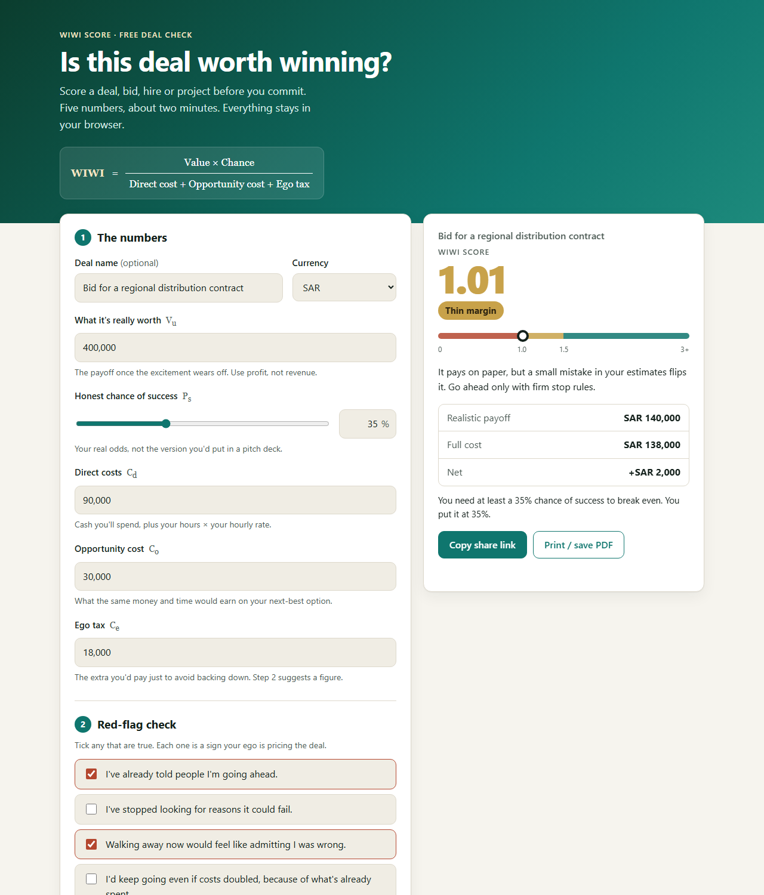

# WIWI: is this deal worth winning?

A free one-page calculator that scores a deal, bid, hire or project **before** you commit, so the decision doesn't rest on excitement or pride.

**▶ Try it live: https://shamoilp.github.io/wiwi-calculator/**



## The formula

```
          Value × Chance of success
WIWI = ───────────────────────────────────────
        Direct cost + Opportunity cost + Ego tax
```

| Input | What to enter |
|---|---|
| **Value** (V<sub>u</sub>) | What the win is really worth once the excitement fades. Use profit, not revenue |
| **Chance of success** (P<sub>s</sub>) | Your honest odds, not the version you'd pitch to an investor |
| **Direct cost** (C<sub>d</sub>) | Cash you'll spend, plus your hours × your hourly rate |
| **Opportunity cost** (C<sub>o</sub>) | What the same money and time would earn on your next-best option |
| **Ego tax** (C<sub>e</sub>) | The extra you'd pay just to avoid backing down |

## Reading the score

| Score | Verdict | Meaning |
|---|---|---|
| Below 1.0 | 🔴 Expensive regret | The realistic payoff doesn't cover the full cost |
| 1.0 to 1.5 | 🟡 Thin margin | It pays on paper, but a small estimating error flips it |
| 1.5 and above | 🟢 Worth pursuing | The payoff clearly beats the full cost |

The tool also shows the **chance of success you'd need to break even**, which is often the most useful number on the page.

## What else it does

- **Red-flag check.** Five yes/no questions that catch ego-driven decisions: public commitment, sunk costs, rivalry. Each "yes" suggests adding 10% of direct costs as ego tax.
- **Stop rule.** You write down "I walk away if…" before you start, while you're still calm.
- **Share link.** The numbers are saved in the link, so you can send a scored deal to a partner or client.
- **Print / save PDF.** A one-page summary with the score, red flags and stop rule.
- **Free score, simple unlock.** Anyone can see their score. To download the PDF or copy the share link, they leave a name and an email or WhatsApp number and tick a consent box. Each unlock lands as a row in a private Google Sheet. Setup: [`apps-script/README.md`](apps-script/README.md).
- **Private by default.** The numbers stay in the browser while you use the calculator. They are only sent if you unlock the report, and only after you agree. After unlocking, the numbers are kept in the page address so share links work, which means they also show up in your browser history.

## Run it locally

No build step and no dependencies. Serve the folder with any static server:

```bash
python3 -m http.server 8000
# open http://localhost:8000
```

Tests (Node 20+):

```bash
npm install   # only needed for the page tests (jsdom)
npm test
```

There are 69 tests: the formula, validation and share links (`src/wiwi.js`), the contact form (`src/leads.js`), the page and unlock flow (`src/app.js`), and the Google Sheet script (`apps-script/Code.gs`, run against fake Google services).

## Credit

The WIWI formula and the idea of an "ego tax" come from the article **"ROI of Ego"** in *Business Advisor* (Shrinikethan, Chennai; edited by [D. Murali](https://www.linkedin.com/in/muralide/)), issue of 25 October 2026. The 1.5 band, red-flag questions, ego-tax suggestion and break-even figure are this tool's additions.

This is a thinking aid, not financial advice.

## About

Built by **Shamoil Plumber**, an accountant and tax advisor working with businesses in Saudi Arabia. See my [GitHub profile](https://github.com/shamoilp) or connect on [LinkedIn](https://www.linkedin.com/in/shamoilp/).

MIT licence.
